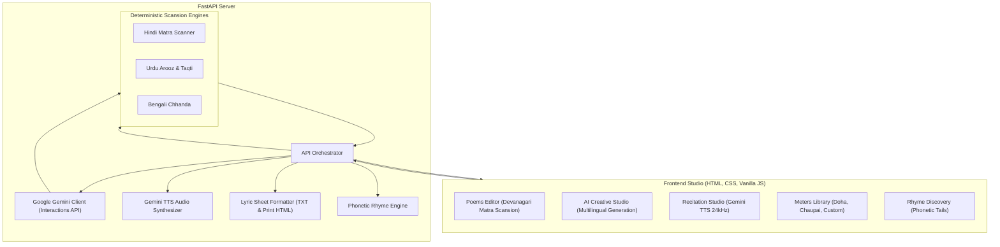

# Chhand (छंद)

**A multilingual, meter-aware poetry writing and recitation studio.**

Chhand brings together classical South Asian poetic prosody and modern generative AI. It combines deterministic meter analysis engines for **Hindi**, **Urdu**, and **Bengali** with **Google Gemini** for meter-verified creative generation, interactive line rewrites, and 24kHz text-to-speech recitation.

---

## What Chhand Does

Chhand provides five integrated creative workspaces:

### 1. Poems (Hindi Meter Editor)
- Interactive writing canvas for traditional Hindi matra-based forms (Doha, Chaupai, and Custom patterns).
- Real-time scansion calculating Laghu (•, 1 matra) and Guru (—, 2 matras) weights.
- Visual akshara-by-akshara breakdowns, caesura indicators, and cumulative matra bars.
- AI-powered line rewriting with deterministic meter verification.
- Rhyme assistant linked directly to your active writing section.

### 2. Create (Multilingual AI Creative Studio)
- Compose original verse in **Hindi (Devanagari)**, **Urdu (Nastaliq, RTL)**, or **Bengali (Bangla)**.
- Choose classical forms:
  - **Hindi**: Doha (13 · 11), Chaupai (16 · 16), or Free Verse.
  - **Urdu**: Ghazal with classical Bahrs (Hazaj, Ramal, Mutaqarib, Kamil, Khafif), Nazm, or Azad Nazm.
  - **Bengali**: Aksharbritta / Payar (14 aksharas), Matrabritta (6+6), Swarabritta (4+4 dals), or Free Verse.
- Specify theme, emotional tone, stanza count, and custom instructions.
- Every generated candidate is independently scanned by the language's prosody engine before display.

### 3. Recite (TTS Audio Studio)
- Recite verses line-by-line using **Gemini 3.8 Flash TTS** at 24kHz audio quality.
- Select from multiple voice personas (*Kore*, *Puck*, *Fenrir*, *Aoede*, *Charon*).
- Choose poetic cadence styles (*Natural Poetry Recitation*, *Slow Meditative*, *Dramatic Emotional*, *Conversational*).
- Visual line tracking: each poetic line illuminates during playback with natural caesura pauses.
- Solo playback controls for individual lines.

### 4. Meters (Classical Patterns Library)
- Interactive reference guide to Doha, Chaupai, and custom matrik patterns.
- Custom meter builder for experimenting with arbitrary matra structures.

### 5. Rhymes (Phonetic Rhyme Assistant)
- Search for Hindi rhymes matching ending sounds and phonetic tails.
- Explore rhyming families and insert chosen words directly into your active verse.

### 6. Export (Professional Lyric Sheets)
- Generate publication-ready lyric sheets.
- **Print-Ready HTML**: Styled web sheet with Google Fonts (*Tiro Devanagari*, *Noto Nastaliq Urdu*, *Noto Sans Bengali*), RTL layout, and responsive print media styling.
- **Plain Text (.txt)**: Clean UTF-8 text file with structured metadata headers.

---

## Architecture



### Deterministic Scansion Principle

Chhand follows a strict architectural boundary:
- **Language models generate ideas, alternatives, and speech.**
- **Deterministic linguistic engines verify and enforce poetic meter.**

No generated line is certified as metered solely because the LLM claimed it fits. Each line must pass through independent, rule-based computational phonology scanners.

---

## Multilingual Engine Details

### Hindi Matra Engine (`app/meter/`)
- Analyzes Devanagari Unicode codepoints into akshara units.
- Evaluates short vowels (Laghu •) vs long vowels and conjuncts (Guru —).
- Validates Doha ($13 + 11 + 13 + 11$) and Chaupai ($16 + 16 + 16 + 16$) rules with position-exact diagnostics.

### Urdu Arooz Engine (`app/meter/urdu/`)
- Normalizes Nastaliq/Arabic script with diacritic and Tanwin handling.
- Implements classical **Taqti** (تقطیع) syllabification mapping to Mutaharrik (Short $S$) and Sakin (Long $L$) weights.
- Scans verses against classical Bahrs:
  - **Bahr-e-Hazaj Musamman Salim** (`mafā'īlun mafā'īlun mafā'īlun mafā'īlun`)
  - **Bahr-e-Ramal Musamman Makhboon** (`fā'ilātun mafā'ilun fa'ilun`)
  - **Bahr-e-Mutaqarib Musamman Salim** (`fa'ūlun fa'ūlun fa'ūlun fa'ūlun`)
  - **Bahr-e-Kamil** (`mutafā'ilun mutafā'ilun`)
  - **Bahr-e-Khafif** (`fā'ilātun mafā'ilun fa'lān`)
- Extracts and validates **Radif** (ردیف) and **Qafiya / Harf-e-Ravi** (قافیہ و حرفِ روی).

### Bengali Chhanda Engine (`app/meter/bengali/`)
- Handles Bengali Unicode normalization and consonant-Nukta decomposition (`ড়`, `ঢ়`, `য়`).
- Segments words into phonetic **Dals** (দল) distinguishing open (*Mukto-dal*) from closed (*Ruddho-dal*).
- Implements the three canonical Bengali metrical systems:
  - **Aksharbritta (অক্ষরবৃত্ত)**: Traditional composite syllabic meter, including Payar (14 aksharas: $8 + 6$).
  - **Matrabritta (মাত্রাবৃত্ত)**: Quantitative moraic meter with open dal = 1, closed dal = 2 (e.g. Tagore's $6 + 6 = 12$ matra rhythm).
  - **Swarabritta / Dalbritta (দলবৃত্ত / স্বরবৃত্ত)**: Folk stress-timed meter counting spoken pulses ($4 + 4$ dals).

---

## API Overview

The FastAPI backend exposes the following endpoints:

| Method | Endpoint | Description |
|---|---|---|
| `GET` | `/api/health` | Application status and Gemini readiness |
| `GET` | `/api/languages` | Supported languages and capability descriptors |
| `POST` | `/api/analyze` | Scans Hindi charans against Doha, Chaupai, or custom targets |
| `POST` | `/api/analyze/urdu` | Scans Urdu verse against classical Bahrs with Taqti |
| `POST` | `/api/analyze/bengali` | Scans Bengali verse across Aksharbritta, Matrabritta, or Swarabritta |
| `POST` | `/api/generate` | Generates original poetry with meter verification |
| `POST` | `/api/rewrite` | Suggests meter-verified alternatives for an off-target line |
| `POST` | `/api/tts` | Synthesizes poetic line to 24kHz mono WAV audio |
| `GET` | `/api/tts/voices` | Returns catalog of available recitation voices |
| `GET` | `/api/tts/styles` | Returns catalog of expressive cadence styles |
| `POST` | `/api/export` | Generates downloadable `.txt` or print-ready `.html` lyric sheets |
| `POST` | `/api/rhyme` | Searches Hindi rhyming words by phonetic tail |
| `GET` | `/api/rhyme/families` | Returns available rhyming categories |

Interactive OpenAPI documentation is available locally at `/docs`.

---

## Repository Layout

```text
chhand/
├── app/
│   ├── api/             # FastAPI endpoints (generate, tts, export, analyze, etc.)
│   ├── export/          # Lyric sheet formatting (plain text & print-ready HTML)
│   ├── languages/       # Multilingual capability descriptors & registry
│   ├── llm/             # Gemini SDK client, model router, and rewrite loop
│   ├── meter/           # Prosody and scansion engines
│   │   ├── hindi/       # Devanagari aksharas, weights, and matra rules
│   │   ├── urdu/        # Arooz, Taqti, Bahrs, Radif, and Qafiya
│   │   └── bengali/     # Aksharbritta, Matrabritta, and Swarabritta
│   ├── poetry/          # Prompt orchestration, scansion validators, and generator
│   ├── rhyme/           # Hindi phonetic rhyme extraction and matching
│   ├── tts/             # Gemini TTS audio synthesizer, voices, and audio formatting
│   ├── config.py        # Environment settings (Gemini API keys, models, timeouts)
│   ├── schemas.py       # Pydantic request/response models
│   └── main.py          # FastAPI application entry point
├── data/
│   ├── sample_dohas.json
│   ├── sample_chaupais.json
│   ├── broken_examples.json
│   ├── bengali/         # Classical Bengali poetry fixtures
│   └── rhyme_words.txt
├── public/              # Static frontend (HTML, CSS, Vanilla JS)
│   ├── index.html       # Single-page studio interface
│   ├── styles.css       # Complete typography & responsive layout system
│   └── js/              # Modular vanilla JS controllers
│       ├── api.js       # Pure fetch API wrappers
│       ├── app.js       # Main application coordinator
│       ├── createPage.js# AI generation studio controller
│       ├── recitePage.js# TTS recitation studio controller
│       ├── exportPanel.js# Lyric sheet export modal controller
│       ├── editor.js    # Interactive Devanagari poetry editor
│       ├── metersPage.js# Meters reference library
│       ├── rhymesPage.js# Rhyme search interface
│       ├── meterBar.js  # Scansion breakdown drawers
│       └── navigation.js# Client-side hash router
├── tests/               # 99+ automated pytest tests across all modules
├── training/            # Fine-tuning datasets, validation scripts, and GCP job submitter
├── requirements.txt     # Production dependencies
├── requirements-dev.txt # Development & test dependencies
└── vercel.json          # Serverless deployment configuration
```

---

## Running Locally

### 1. Prerequisites
- Python 3.11+
- Google Gemini API Key (optional for meter scansion, required for AI generation, rewriting, and TTS recitation)

### 2. Setup

```bash
# Clone the repository
git clone https://github.com/aiyaniqbal/chhand.git
cd chhand

# Create virtual environment
python -m venv .venv

# Activate on Windows
.venv\Scripts\activate
# Or on macOS/Linux:
# source .venv/bin/activate

# Install dependencies
pip install -r requirements.txt
pip install -r requirements-dev.txt
```

### 3. Environment Configuration

Create a `.env` file from `.env.example`:

```env
GEMINI_API_KEY=your_gemini_api_key_here
GEMINI_MODEL=gemini-3.8-flash
GEMINI_TIMEOUT_SECONDS=30
GEMINI_MAX_CANDIDATES=4
MAX_RETRIES=3
```

*(Note: The deterministic meter scanners, rhyme lookup, and lyric sheet export run offline without requiring an API key).*

### 4. Start the Studio

```bash
uvicorn app.main:app --reload
```

Open your browser at `http://localhost:8000`.

---

## Testing & Quality

Run the test suite:

```bash
python -m pytest -q
```

All 99 unit and integration tests execute synchronously in under 0.5s:
- **Hindi Meter**: Aksharas, weights, Dohas, Chaupais, and edge-case schwas.
- **Urdu Arooz**: Taqti syllabification, 5 classical Bahrs, Radif and Qafiya.
- **Bengali Chhanda**: Dal segmentation, Nukta normalization, Payar 14, Matrabritta 12, and Swarabritta 8.
- **Poetry Generation**: Prompt construction, language validation, and scansion ranking.
- **TTS Recitation**: Audio conversions (PCM to WAV), header validation, duration calculations, and mock synthesis.
- **Lyric Sheet Export**: Text formatting, HTML generation with RTL & web fonts, and ASCII header safety.

Lint and format checks:

```bash
python -m ruff check .
python -m ruff format --check .
```

---

## License

This project is licensed under the MIT License. See [LICENSE](LICENSE) for details.
